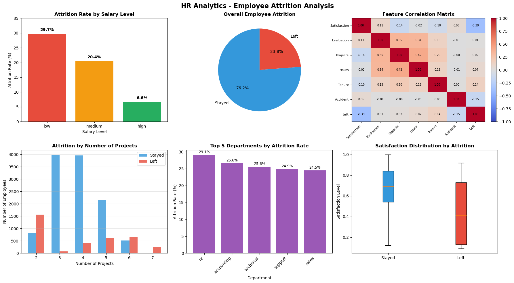

# Employee Attrition Analysis and HR Statistics GUI

Python-based exploration of employee attrition using control structures, reusable functions, Pandas, data visualisations, and a simple Tkinter interface.

## Overview

This project analyses an HR dataset to examine how employee departure patterns vary with satisfaction, salary level, workload, number of projects, and department. The notebook progresses from basic Python logic to grouped data analysis and visual reporting. A small desktop GUI displays employee counts and attrition rates by salary category.

## Visualisation preview



## Included features

- Count and classify employee departures using loops and conditional statements.
- Calculate attrition rates by salary band and department with reusable Python functions.
- Explore employee satisfaction and working hours using Pandas and descriptive statistics.
- Build charts comparing employee departures, projects, salary levels, departments, and correlations.
- Select a salary group in a Tkinter window to view employee counts and attrition rates.

## Notebook sections

1. Control Structures
2. Functions and Modules
3. Data Handling with Pandas
4. Data Visualization
5. GUI Development
6. Conclusion and Critical Appraisal

## Getting started

1. Download or clone this repository.
2. Install Python 3 and the dependencies:

   ```bash
   pip install -r requirements.txt
   ```

3. Open `HR_Employee_Attrition_Analysis.ipynb` in Jupyter Notebook or JupyterLab.
4. Run the cells in order. The notebook's first setup cell uses `gdown` to attempt to download `HR_comma_sep.csv` from a Google Drive link. If the link is unavailable, download the HR Analytics dataset from the source below and place the CSV beside the notebook.
5. Run the Tkinter cell from a local desktop environment with a graphical display. Some hosted notebook services cannot open desktop windows.

## Dataset

HR Analytics dataset: [Kaggle, HR Analytics](https://www.kaggle.com/datasets/giripujar/hr-analytics)

Expected CSV filename: `HR_comma_sep.csv`. The dataset is not bundled in this repository.

## Technologies

Python, Pandas, NumPy, Matplotlib, Tkinter, Jupyter Notebook, and gdown.

## Notes

The employee risk labels use illustrative rules. Correlations and associations in the dataset do not establish the causes of employee departures. The Tkinter interface is intended for local execution.

## References

- [HR Analytics dataset on Kaggle](https://www.kaggle.com/datasets/giripujar/hr-analytics)
- [gdown project](https://github.com/wkentaro/gdown)
